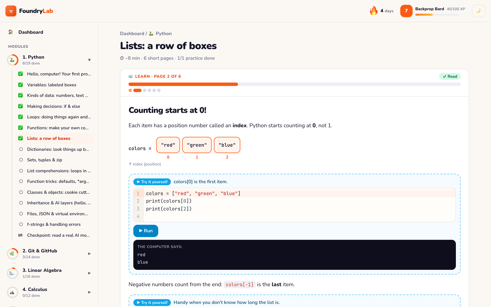

# ⚒ FoundryLab

**Learn the foundations of Generative AI by *doing*, starting from zero.**

FoundryLab teaches Python, Git, Linear Algebra, Calculus and Probability in your browser, simple enough that a curious kid can follow along. Every lesson is a few short pages with everyday comparisons, pictures, code you can run on the spot and quick check questions. Then you practice in labs that grade your work instantly.

Real Python (and NumPy) runs in your browser through [Pyodide](https://pyodide.org). No installs, no accounts, no backend, no API keys.




## At a glance

| | |
| --- | --- |
| 📚 Lessons | **59**, made of **334** short pages |
| ▶ Try it examples | **142** runnable code snippets inside the lessons |
| 🧪 Code labs | **50**, auto-graded with hidden tests |
| ⌨️ Terminal challenges | **11** in a safe, simulated Git terminal |
| ❓ Quizzes | **8** (plus quick checks on almost every lesson) |
| 🎡 Playgrounds | **5** drag-and-play math widgets, each with a challenge |
| 🏅 Badges | **16** |

## The curriculum

Every module starts from the very basics and builds up to how AI actually uses the idea.

**🐍 Python (16 lessons).** Hello, computer! Your first program · Variables: labeled boxes · Kinds of data · Making decisions: if & else · Loops · Functions · Lists · Dictionaries · Sets, tuples & zip · List comprehensions · Function tricks: defaults, \*args, \*\*kwargs & lambda · Classes & objects · Inheritance & AI layers (nn.Module) · Files, JSON & virtual environments · f-strings & handling errors · **Checkpoint:** read a real AI model

**🌿 Git & GitHub (11 lessons).** What is version control? · The terminal: typing commands · git init & git status · Staging & committing · git log · Branches · Merging · GitHub: clone, push & pull · Merge conflicts (don't panic!) · .gitignore & README · **Checkpoint:** fork, PR & issues

**📐 Linear Algebra (11 lessons).** Numbers on a grid · Vectors: arrows made of numbers · Meet NumPy · Adding & stretching vectors · How long is an arrow? · Dot product · Matrices: tables of numbers · Multiplying matrices, step by step · Flip, do-nothing & undo matrices · Cosine similarity: how AI compares meanings · **Checkpoint:** shape master

**⛰️ Calculus (10 lessons).** Functions are machines · Graphs · Slope: how steep is it? · Derivatives: the slope of a curve · Handy derivative shortcuts · Chain rule = backprop · Loss: how wrong am I? · Partial derivatives & gradients · Gradient descent & learning rate · **Checkpoint:** train a one-knob model

**🎲 Probability & Stats (11 lessons).** What is probability? · Experiments: flipping coins with Python · Conditional probability · Next-word prediction: how autocomplete works · Distributions & the bell curve · Mean, variance & standard deviation · Normalization · Softmax · Sampling & temperature · Accuracy, precision & recall · **Checkpoint:** think like a sampler

## How a lesson works

1. **Learn, one page at a time.** Each page explains a single idea and uses some of these:
   - **🧸 Think of it like this:** an everyday comparison (a variable is a labeled box, Git is a video-game save point).
   - **Pictures:** lists drawn as rows of boxes, tables for matrices, and worked examples done step by step with real numbers.
   - **▶ Try it yourself:** a small code box you can edit and run, with no grading.
   - **🤔 Quick check:** a question that just says "try another!" if you pick wrong.
   - **📖 New words:** a short glossary of every new term.
2. **Practice.** It unlocks when you finish the pages (or tap "I already know this"). Reading the pages earns 10 XP.
3. **Labs.** Each lab has numbered "what to do" steps, a starter code box, **Run** and **Check** buttons, and hints.

## Features

- **Instant grading.** **Check** runs hidden tests and explains each result in plain words.
- **Hints that go step by step.** You get a nudge first, then more detail, then the approach. **Show solution** unlocks only after 2 failed checks or once every hint has been used.
- **Friendly errors.** You see the real Python traceback plus a one-line plain-English explanation. Code that runs longer than 8 seconds (an infinite loop, say) is stopped safely.
- **5 playgrounds**, each with a challenge:
  - **Dot product:** drag two arrows and watch the number change.
  - **Cosine similarity:** see how AI compares meanings by direction.
  - **Matrix shapes:** find out which shapes can multiply.
  - **Gradient descent:** roll a ball down a valley and watch it overshoot when the learning rate is too high.
  - **Temperature:** make a chatbot's next-word choices sharper or more random.
- **Git simulator.** A forgiving pretend terminal with step-by-step challenges, command history (↑/↓) and hints. Nothing touches your real files.
- **Gamification.**
  - XP and levels: Curious Spark → Token Tinkerer → Tensor Apprentice → … → Foundry Master.
  - A daily streak flame that grows.
  - 16 badges and a progress ring for every module.
  - Confetti, and a daily challenge picked from topics you've already finished.
- **Saves automatically.** Progress, streaks, badges, quiz scores, your code, theme and your last lesson are kept in your browser (`localStorage`). If storage is blocked, the app still works.
- **Dark and light mode, and works on phones.**

## Run it locally (under 5 minutes)

You need **Node.js 20 or newer**.

```bash
git clone https://github.com/tarundattagondi/foundrylab.git
cd foundrylab
npm install
npm run dev
```

Open the address it prints (usually http://localhost:5173). The first time you run code, the browser downloads the Python engine (about 10 MB). After that it's cached.

| Command | What it does |
| --- | --- |
| `npm run dev` | Start the app with live reload |
| `npm run build` | Make a production build in `dist/` |
| `npm run preview` | Serve that production build locally |
| `npm run verify` | Check all lesson content (needs local `python3` and `numpy`) |

`npm run verify` confirms that every lab's solution passes its tests, every starter fails, every Try-it example runs and every quiz answer is valid. `node scripts/verify-git.mjs` plays through every terminal challenge.

## How it works

```
Browser
 ├─ React UI (Vite + Tailwind)
 ├─ CodeMirror 6 editor
 └─ Web Worker ── Pyodide (Python compiled to WebAssembly, loaded from the jsDelivr CDN)
                   └─ harness.py: runs your code, captures what it prints, runs hidden tests
```

- **`src/lib/pyodideRunner.js`** starts the Python engine in a Web Worker the first time you run code, then keeps it ready for every lesson. NumPy is fetched the first time it's imported. Running Python off the main page keeps everything smooth and lets runaway code be stopped.
- **`src/lib/harness.py`** runs your code in a fresh space. On **Check** it runs each hidden test and reports pass or fail with a friendly message.
- **`src/lib/progress.js`** stores XP, streaks, badges and progress in `localStorage`.
- **`src/lib/gitSim.js`** is the pretend Git used by the terminal challenges.

### Project layout

```
src/
  data/
    curriculum.js        # puts the modules together + lookup helpers
    helpers.js           # the lesson format (documented at the top) + XP values
    modules/             # one file per module: all lessons, labs and quizzes
      python-basics.js   #   Python lessons 1-9
      python.js          #   Python lessons 10-16 + module info
      git.js  linalg.js  calculus.js  probability.js
  lib/                   # Python engine, grading harness, progress, git simulator
  components/            # lesson pages, labs, quizzes, terminal, playgrounds, dashboard
scripts/                 # content checkers (verify-labs.mjs, verify-git.mjs)
docs/                    # README screenshots
```

## Add a new lesson or lab

Open the module's file in **`src/data/modules/`**. Every block and activity type is listed at the top of **`src/data/helpers.js`**.

A lesson has `learn` pages (one small idea each) and `activities` (practice):

```js
{
  id: 'py-word-count',
  title: 'Counting words',
  minutes: 6,
  learn: [
    {
      title: 'What are we doing?',
      blocks: [
        { big: 'Let\'s count words!' },
        { analogy: 'Like tallying votes on a whiteboard.', emoji: '🗳️' },
        { tryit: py`print("a b a".split())`, note: 'split() breaks text into words.' },
        { quick: { q: 'How many words in "hi there"?', options: ['1', '2'], answer: 1, explain: 'Two words.' } },
        { words: [['split', 'breaks text into a list of words']] },
      ],
    },
  ],
  activities: [
    {
      type: 'code',
      id: 'py-word-count-lab',          // unique id (used to save progress)
      title: 'Count words',
      xp: XP.code,
      task: 'Write `word_count(text)` returning a dict of word → count.',
      steps: ['Split the text into words', 'Count each word in a dict', 'Return the dict'],
      starter: py`
def word_count(text):
    pass
`,
      solution: py`
def word_count(text):
    counts = {}
    for w in text.split():
        counts[w] = counts.get(w, 0) + 1
    return counts
`,
      tests: [
        { name: 'counts repeated words', fail: 'Split on spaces, then count', code: py`
_r = word_count("a b a")
assert _r == {"a": 2, "b": 1}, f"got {_r!r}"
` },
      ],
      hints: ['A dict can store counts.', 'Use counts.get(w, 0) + 1', 'Loop over text.split()'],
    },
  ],
},
```

- Put the lesson in a module's `lessons` array and it shows up in the sidebar automatically.
- Other page blocks: `code`, `steps`, `list`, `boxes`, `table`, `tip` and `warn`.
- Tests are plain Python `assert`s that run after the learner's code. Start helper variable names with `_`. `__source__` holds the learner's code and `__stdout__` what it printed.
- Other activity types: `quiz`, `git` (terminal steps with a `check(state, cmd)` function) and `viz` (one of the 5 playgrounds).
- Run `npm run verify` (or `node scripts/verify-labs.mjs python` for one module) before you commit.

## Deploy for free

**Vercel:** import the repo at [vercel.com/new](https://vercel.com/new). It detects Vite automatically (build command `npm run build`, output folder `dist`). Click Deploy.

**GitHub Pages:** the build uses relative paths (`base: './'`), so `dist/` works from any sub-folder. Publish `dist/` to a `gh-pages` branch, or use GitHub's "Deploy static content" Action with `path: dist`.

## License

[MIT](LICENSE). Use it, fork it, teach with it.
