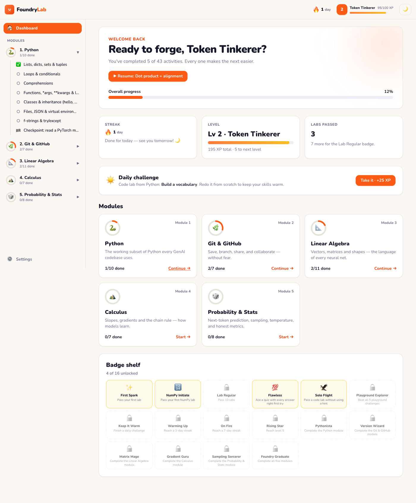

# ⚒ FoundryLab

**Learn the foundations of Generative AI by *doing*.** FoundryLab is a gamified, hands-on lab in your browser: bite-sized lessons followed immediately by labs with instant feedback. Real Python (and NumPy) runs in your browser through [Pyodide](https://pyodide.org). No backend, no accounts, no API keys.


<!-- Screenshot placeholder: replace docs/screenshot.png with your own. -->

## What's inside

| Module | You practice |
| --- | --- |
| 🐍 **Python** | lists/dicts/sets/tuples, loops, comprehensions, `*args`/`**kwargs`/lambda, classes as `nn.Module`, files & JSON, venv/pip, f-strings, try/except |
| 🌿 **Git & GitHub** | init/add/commit, branches & merges, clone/push/pull, merge conflicts, `.gitignore`, README, fork/PR/issues, all in a simulated terminal |
| 📐 **Linear Algebra** | vectors, dot products, matrix multiplication & shapes, transpose/identity/inverse, element-wise vs matrix ops, cosine similarity (NumPy) |
| ⛰️ **Calculus** | derivatives, the chain rule as backprop, gradients, gradient descent & learning rate |
| 🎲 **Probability & Stats** | conditional probability as next-token prediction, Gaussians, mean/variance/std, normalization, softmax + temperature sampling, precision/recall |

## Features

- **26 auto-graded Python labs.** Your code runs on Pyodide. **Check** runs hidden tests and reports each one in plain words.
- **Progressive hints.** You get a nudge first, then more detail, then the approach. **Show solution** unlocks after 2 failed checks or once you've used every hint.
- **Clear errors.** You see the real traceback plus a one-line plain-English explanation. Code that runs over 8 seconds (an infinite loop, say) is stopped safely.
- **5 interactive playgrounds**, each with a challenge:
  - **Dot product:** drag the vectors.
  - **Cosine similarity:** see how embeddings compare by direction.
  - **Matrix shapes:** test which shapes can multiply.
  - **Gradient descent:** roll a ball down a valley and watch it overshoot when the learning rate is too high.
  - **Temperature:** watch sampling get sharper or flatter.
- **Git simulator.** A forgiving fake terminal with scripted challenges, command history (↑/↓) and hints.
- **Checkpoint quizzes.** Wrong answers get a nudge, not a scolding.
- **Gamification:**
  - XP and levels: Curious Spark → Token Tinkerer → Tensor Apprentice → Gradient Wrangler → …
  - A daily streak flame that grows each day.
  - 16 badges and a progress ring for every module.
  - Confetti, and a daily challenge picked from topics you've already finished.
- **Saves locally.** Progress, streaks, badges, quiz scores, your code drafts, theme, and your last lesson are all stored in `localStorage`. If storage is blocked, the app still works.
- **Dark and light mode, and mobile-friendly.** The editor and playgrounds work on phones.

## Run it locally (under 5 minutes)

You need **Node.js 18+**.

```bash
git clone https://github.com/<you>/foundrylab.git
cd foundrylab
npm install
npm run dev
```

Open the URL Vite prints (usually http://localhost:5173). The first code lab downloads the Python engine (~10 MB, cached by your browser afterwards).

| Script | What it does |
| --- | --- |
| `npm run dev` | Start the dev server with hot reload |
| `npm run build` | Production build into `dist/` |
| `npm run preview` | Serve the production build locally |
| `npm run verify` | Check every lab: the reference solution must pass, the starter must fail (needs local `python3` + `numpy`) |

## How it works

```
Browser
 ├─ React UI (Vite + Tailwind)
 ├─ CodeMirror 6 editor
 └─ Web Worker ── Pyodide (CPython compiled to WebAssembly, loaded from jsDelivr CDN)
                   └─ harness.py: runs your code, captures stdout, runs hidden tests
```

- `src/lib/pyodideRunner.js` lazily starts a Web Worker the first time you open a code lab. The worker loads Pyodide once and keeps it warm for every lab after that. NumPy is fetched the first time a lab imports it. Running Python off the main thread keeps the UI smooth and lets us kill runaway code.
- `src/lib/harness.py` runs your code in a fresh namespace. On **Check** it runs each hidden test against that namespace and returns pass/fail with friendly messages.
- `src/lib/progress.js` holds all XP, streak, badge and completion state in `localStorage`.
- `src/lib/gitSim.js` is a small pure-JS git simulator.

## Add a new lab

All content lives in **`src/data/curriculum.js`**. To add a lab, append an object to a lesson's `activities` array:

```js
{
  type: 'code',
  id: 'py-word-count',            // unique id (used for progress)
  title: 'Count words',
  xp: XP.code,
  numpy: false,                   // true if it uses NumPy (for the badge)
  task: 'Write `word_count(text)` returning a dict of word → count.',
  starter: py`
def word_count(text):
    pass
`,
  solution: py`
def word_count(text):
    counts = {}
    for w in text.split():
        counts[w] = counts.get(w, 0) + 1
    return counts
`,
  tests: [
    { name: 'counts repeated words', fail: 'Split on spaces, then count', code: py`
_r = word_count("a b a")
assert _r == {"a": 2, "b": 1}, f"got {_r!r}"
` },
  ],
  hints: ['A dict can store counts.', 'Use counts.get(w, 0) + 1', 'Loop over text.split()'],
},
```

- Tests are plain Python `assert`s that run after the learner's code, in the same namespace. Prefix your helper variables with `_` to avoid clashing with theirs. `__source__` holds the learner's code and `__stdout__` holds what it printed.
- The `py` tag keeps backslashes and trims indentation edges, so write Python exactly as you would in a `.py` file.
- Run `npm run verify` to confirm your solution passes and the starter fails.

The other activity types are `quiz` (questions with `options`, `answer`, `explain`), `git` (`setup` plus `steps` with a `check(state, cmd)` function) and `viz` (one of the playground components). A new lesson is just an object in a module's `lessons` array, and it shows up in the sidebar automatically.

## Deploy for free

**Vercel:** import the GitHub repo at [vercel.com/new](https://vercel.com/new). It detects Vite automatically (build: `npm run build`, output: `dist`). Click Deploy.

**GitHub Pages:** the build uses relative paths (`base: './'`), so `dist/` works from any sub-path. Push `dist/` to a `gh-pages` branch, or use the official "Deploy static content" GitHub Action with `path: dist`.

## License

[MIT](LICENSE). Use it, fork it, teach with it.
